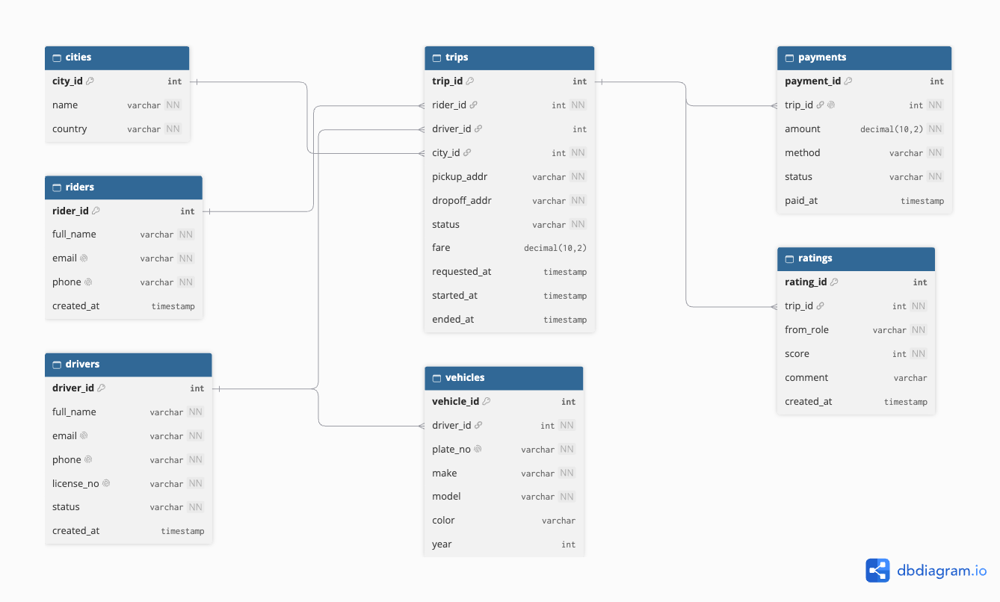

# Portfolio 1 — Database Design and Modelling

**Case study:** Supalogi, a ride-hailing platform that connects riders to drivers,
handles trips and payments, and collects ratings. Full description: [case-study.md](../case-study.md).

## Files
| File | What it is |
|---|---|
| `schema.dbml` | ER diagram source — paste into [dbdiagram.io](https://dbdiagram.io) to view/export the picture |
| `schema.sql` | PostgreSQL tables with keys, foreign keys, and constraints |
| `seed.sql` | Sample data to test the design |
| `normalisation.md` | Explanation of 1NF → 3NF |

## Tables
- **cities** — regions (used later for sharding)
- **riders** — people booking trips
- **drivers** — people driving
- **vehicles** — each driver's car
- **trips** — a booking linking one rider + one driver + one city
- **payments** — one payment per trip
- **ratings** — rider and driver each rate a trip once

## Keys and constraints
- **Primary key:** identifies a certain row, e.g. `trip_id` picks out one trip. No two
  rows can share it.
- **Foreign key:** `trips.rider_id` points to `riders.rider_id`. Adding a trip for a rider
  who doesn't exist throws an error, so every trip belongs to a registered, valid rider.
- **UNIQUE:** `payments.trip_id` is unique, so a trip can only have one payment.
- **CHECK:** only allows values that pass a test. A rating of 7 is rejected because of
  `CHECK (score BETWEEN 1 AND 5)`, and a payment of -2800 is rejected because of
  `CHECK (amount >= 0)` (tested in Portfolio 3).

## How to run
```bash
createdb -U postgres supalogi
psql -U postgres -d supalogi -f schema.sql
psql -U postgres -d supalogi -f seed.sql
```

## ER diagram


Made by pasting `schema.dbml` into https://dbdiagram.io and exporting as PNG.

## Testing
The design was tested on PostgreSQL 15 by building the tables, loading the sample
data, and checking the results.

| Test | What it shows | Evidence |
|---|---|---|
| Build tables | `schema.sql` runs with no errors and creates all 7 tables | [1-schema-created.png](screenshots/1-schema-created.png) |
| Load data | `seed.sql` inserts rows into every table | [2-seed-loaded.png](screenshots/2-seed-loaded.png) |
| List tables | `\dt` confirms all 7 tables exist | [3-tables-list.png](screenshots/3-tables-list.png) |
| Read data | `SELECT * FROM trips` returns the sample trips (terminal and pgAdmin) | [4-trips-data.png](screenshots/4-trips-data.png), [4-trips-data-2.png](screenshots/4-trips-data-2.png) |
| Reject bad data | Inserting a trip that starts before it was requested is refused by a CHECK constraint | [5-constraint-check.png](screenshots/5-constraint-check.png) |
